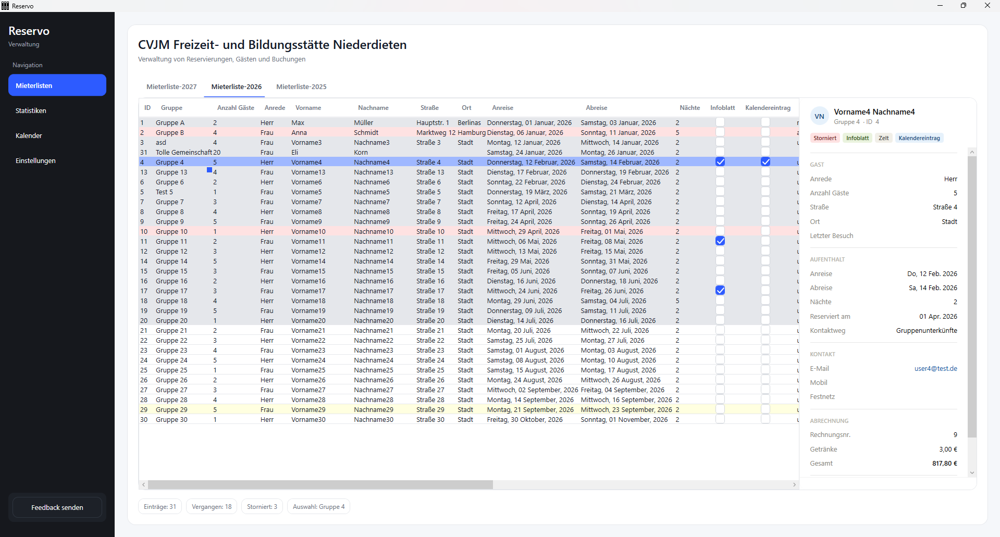
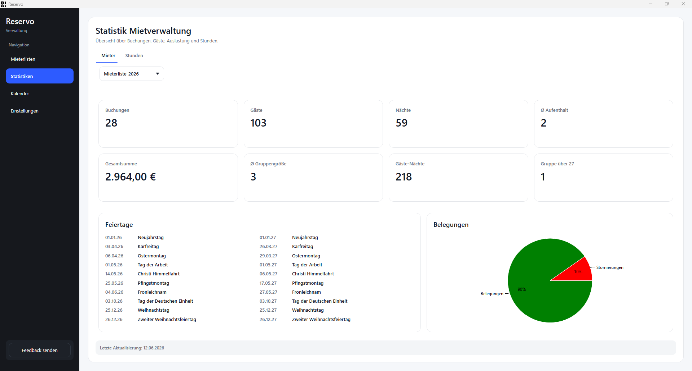
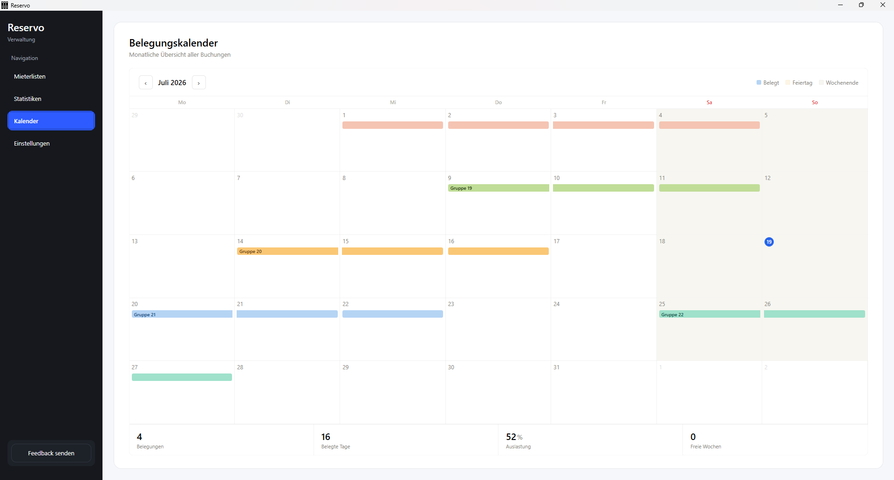

# Reservo

Reservo ist eine Windows-WPF-Anwendung zur Verwaltung von Reservierungen. Sie lädt und speichert Buchungen in jahresbezogenen Excel-Dateien und unterstützt Dokumente, Statistiken, Kalenderansichten und Benachrichtigungen.

Reservo ist ein internes Werkzeug. Vorlagen, Speicherorte und Integrationen sind auf den Einsatz des Projekts zugeschnitten.

## Funktionen

- Reservierungen aus `.xlsx`-Dateien laden, bearbeiten und speichern; beim Speichern werden bis zu fünf Backups pro Datei verwaltet.
- Reservierungsbestätigungen und Rechnungen mit den lokalen Dokumentvorlagen erzeugen.
- Eine E-Mail als vorausgefüllten Entwurf in Mozilla Thunderbird öffnen. Der Versand wird vom Nutzer in Thunderbird ausgelöst.
- Buchungsüberschneidungen anzeigen und Termine als Google-Kalender-Vorlage öffnen.
- Buchungsstatistiken und Kalenderbelegung darstellen.
- Kommende Anreisen als In-App-Benachrichtigungen anzeigen.
- Feedback als Trello-Karte übermitteln.

## Technologien

| Bereich | Technologie |
|---|---|
| Oberfläche | WPF, .NET 8 (`net8.0-windows`) |
| Sprache und Architektur | C#, MVVM |
| Excel | ClosedXML, ExcelDataReader |
| Word und PDF | DocX, Open XML, Microsoft Word Interop |
| E-Mail | MailKit für IMAP; Thunderbird für den E-Mail-Entwurf |
| Diagramme und Feiertage | OxyPlot.Wpf, PublicHoliday |
| Benachrichtigungen und Logging | Notification.Wpf, Serilog |
| Tests | xUnit v3 |

## Voraussetzungen

- Windows 10 oder Windows 11
- .NET 8 SDK und Windows Desktop Runtime
- Visual Studio 2022 oder Visual Studio Build Tools mit .NET-Desktop-Buildkomponenten. Das Projekt enthält Office-COM-Referenzen; zum Bauen wird daher das Visual-Studio-MSBuild für .NET Framework benötigt.
- Microsoft Word für Funktionen, die Word-Interop zur PDF-Erzeugung verwenden
- Mozilla Thunderbird für das Öffnen vorausgefüllter E-Mail-Entwürfe

## Bauen und Starten

Öffne eine **Developer PowerShell for Visual Studio 2022** im Projektordner:

```powershell
msbuild Reservo.sln /restore /t:Build /p:Configuration=Debug
```

Danach kann die Anwendung aus `Reservo\bin\Debug\net8.0-windows\Reservo.exe` gestartet werden. Ein normaler `dotnet build`-Aufruf kann bei den Office-COM-Referenzen mit `ResolveComReference` scheitern; verwende dafür Visual-Studio-MSBuild.

Beim Start verwendet Reservo standardmäßig `Dokumente\Verwaltung` mit den Unterordnern `Datenbank` und `Resources`. Es legt bei Bedarf Excel-Dateien für das aktuelle und das nächste Jahr an. Ein abweichender Datenbankpfad kann in den Anwendungseinstellungen konfiguriert werden.

## Tests

Die Tests zielen auf Windows (`net8.0-windows`). Der Test-Build muss wegen der COM-Referenzen ebenfalls mit Visual-Studio-MSBuild erfolgen. In der Developer PowerShell:

```powershell
msbuild ReservoTest\ReservoTest.csproj /restore /t:Build /p:Configuration=Release
vstest.console.exe ReservoTest\bin\Release\net8.0-windows\ReservoTest.dll
```

Aktuell sichern die Unit-Tests verschachtelte Buchungen, die Zwei-Tage-Toleranz und stornierte Einträge in der Überschneidungsanalyse, die Nullbehandlung bei Statistikdurchschnitten sowie `INotifyPropertyChanged` in `BaseViewModel`. Ein Excel-Speicher-/Lade-Rundlauftest prüft die wichtigsten Buchungsfelder und das Backup in einem temporären Verzeichnis.

Weitere sinnvolle Tests sind Parser-Beispiele aus echten, anonymisierten Buchungstexten, zusätzliche Grenzfälle für Stornierungen und die Zwei-Tage-Toleranz sowie Fehlerpfade beim Speichern. Tests für Word/PDF und externe Dienste sollten als separate Windows-Integrationstests mit kontrollierten Vorlagen beziehungsweise Testkonten laufen; sie sollten keine echten E-Mails oder Trello-Karten versenden.

## Konfiguration und Daten

Die Einstellungen werden in `Dokumente\Verwaltung\Resources\internCredentials.json` gespeichert. Passwörter und Trello-Token werden vor dem Speichern mit AES verschlüsselt. Das Schlüsselmaterial wird aus `CREDENTIAL_API_KEY` abgeleitet; für reproduzierbares Entschlüsseln muss derselbe Wert bei jedem Start gesetzt sein. Der im Quellcode enthaltene Ersatzwert ist nur für lokale Entwicklung gedacht.

Die Excel-Dateien enthalten personenbezogene Daten. Verwende für Tests ausschließlich synthetische oder anonymisierte Daten. Der XLSX-Integrationstest erstellt Dateien in einem temporären Verzeichnis und löscht dieses anschließend.

## Projektstruktur

```
Reservo/
├── Models/          # Buchungs-, Gäste-, Abrechnungs- und Statistikmodelle
├── ViewModels/      # MVVM-Logik und Zustandsverwaltung je Ansicht
├── Views/           # WPF-Views und XAML
├── Services/        # Dokumente, E-Mail, Zugangsdaten, Dateien und Dialoge
├── Helpers/         # Excel-Zugriff, Import und Datumsanalyse
├── Commands/        # ICommand-Implementierungen
├── Converters/      # WPF-Binding-Converter
├── Behavior/        # Wiederverwendbare WPF-Verhaltensweisen
├── Infrastructure/  # Pfade, Logging und gemeinsame Konfiguration
└── Themes/          # Styles und Ressourcen

ReservoTest/         # xUnit-Unit- und Integrationstests
images/              # README-Screenshots
```

## Screenshots






